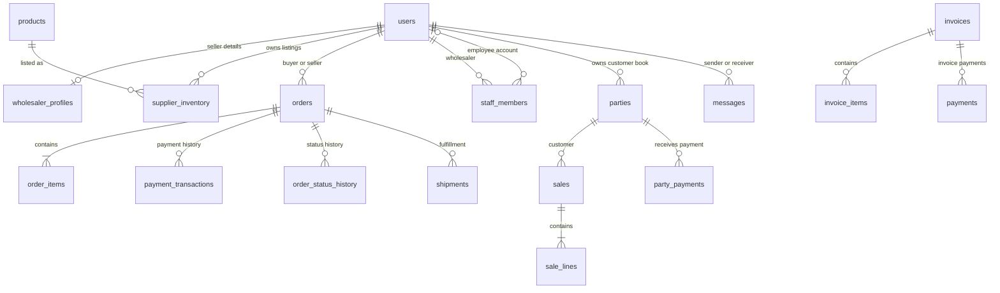

# Wholesale Marketplace

A B2B application for Indian wholesalers and retailers. The React client talks
to an Express API, which stores marketplace and wholesaler-book data in
PostgreSQL. The same database includes older marketplace features and newer
wholesaler tools such as sales, purchases, GST invoices, delivery challans,
staff access, and a stock ledger.

This guide describes what is present in the repository. It does not prove which
migrations have been run on a particular database. The migrations are applied
manually, so the schema shown in pgAdmin can differ from the schema described
here.

## Contents

- [How to read the confidence labels](#how-to-read-the-confidence-labels)
- [Application overview](#application-overview)
- [Database schema and where it comes from](#database-schema-and-where-it-comes-from)
- [Users, registration, and profiles](#users-registration-and-profiles)
- [Roles and staff permissions](#roles-and-staff-permissions)
- [Relationships](#relationships)
- [Important database values](#important-database-values)
- [Database table inventory](#database-table-inventory)
- [Core table column guide](#core-table-column-guide)
- [How forms and API requests reach PostgreSQL](#how-forms-and-api-requests-reach-postgresql)
- [Useful pgAdmin queries](#useful-pgadmin-queries)
- [Glossary](#glossary)
- [Setup and pgAdmin](#setup-and-pgadmin)
- [Questions that need checking](#questions-that-need-checking)

## How to read the confidence labels

- **Confirmed** means the information appears directly in a migration or is
  read or written in the application code.
- **Inferred** means the field name or nearby code suggests the meaning, but
  no validation or explicit description confirms it.
- **Needs verification** means the live database, product decision, or meaning
  cannot be established from the files inspected.

Data types, nullability, defaults, and constraints below describe the
repository's SQL declarations. An `ALTER TABLE` migration can change an older
database differently from a fresh database. Use the pgAdmin queries below to
inspect the database you are actually connected to.

## Application overview

| Part | What it does | Main source files |
|---|---|---|
| React client | Registration, login, shopping, seller dashboard, invoices, sales, purchases, and other forms | `client/src/pages/`, `client/src/components/` |
| Express API | Authentication, authorization, data validation, business rules, and SQL queries | `server/src/routes/`, `server/src/controllers/`, `server/src/services/` |
| PostgreSQL | Stores user accounts and operational records | `server/migrations/` |
| Database access | A shared `pg` connection pool. The application uses SQL in controllers and services; there is no active ORM model layer under `server/src/models/`. | `server/src/config/db.js` |

The API is mounted under `/api` in `server/src/app.js`. Its main route groups
include `/api/auth`, `/api/products`, `/api/orders`, `/api/profile`,
`/api/invoices`, `/api/parties`, `/api/sales`, `/api/purchases`,
`/api/suppliers`, `/api/stock`, `/api/challans`, `/api/notifications`,
`/api/staff`, `/api/masters`, `/api/imports`, and `/api/exports`.

## Database schema and where it comes from

The SQL files in `server/migrations/` are the schema source files. The
repository contains a baseline snapshot in `000_baseline.sql`, followed by
feature and repair migrations. Migrations are not automatically applied at
server startup. `server/run_migrations.js` and the `server` package's
`npm run migrate` script are the migration runner.

There are multiple generations of tables and overlapping migrations. For
example, the baseline describes legacy marketplace and retail tables, while
the `wholesale3_*.sql` migrations add the wholesaler's own customers, sales,
purchases, inventory book, staff, and master data. Some migration files use
`CREATE TABLE IF NOT EXISTS`, which does not update a table that already
exists. The file `align_schema_with_app.sql` also documents legacy column and
type mismatches. Therefore:

1. Treat this README as a map of the repository, not proof of your database's
   migration state.
2. Use `information_schema` queries in pgAdmin to verify the live table and
   column definitions.
3. Do not manually add a column just because the code mentions it. Check the
   migration history and the live schema first.

The migrations declare **77 distinct table names** across the repository,
including old marketplace, retail, accounting, and newer wholesaler-book
features. That count is not a claim that all 77 tables exist in the connected
database. The full table names are in the [table inventory](#database-table-inventory).

## Users, registration, and profiles

### `users`

**Confirmed fields:** `id`, `first_name`, `last_name`, `email`,
`password_hash`, `phone`, `role`, and `created_at` are declared in the
baseline migration. Later migrations add platform administration data.

| Column name | Meaning | Data type | Required? | Default value | Example | Where used |
|---|---|---|---|---|---|---|
| `id` | Unique account identifier. Other records refer to this value. | `uuid` | Yes, primary key | `gen_random_uuid()` | `a UUID generated by PostgreSQL` | Auth queries and foreign-key relationships |
| `first_name` | User's first or given name. | `varchar(100)` | Yes | None | `Asha` | Signup, login response, profile response |
| `last_name` | User's family name. | `varchar(100)` | Yes | None | `Shah` | Signup, login response, profile response |
| `email` | Login and contact email. | `varchar(255)` | Yes | None | `asha@example.test` | Registration duplicate lookup, login |
| `password_hash` | A bcrypt hash of the password, not the plain password. | `varchar(255)` | Yes | None | `[bcrypt hash, never display]` | Written by registration, checked by login |
| `phone` | Phone number supplied by the user. | `varchar(20)` | Yes in baseline | None | `9876543210` | Signup and `/api/auth/me` |
| `role` | Account type used by server role checks. | `varchar(20)` | Yes | None | `buyer` | Signup, JWT claims, role middleware |
| `created_at` | Time account row was created. | `timestamp` | Not declared `NOT NULL` in baseline | `CURRENT_TIMESTAMP` | `2026-10-16 09:00:00` | Registration history and reporting |
| `is_platform_admin` | Platform administrator flag. It is added by a later migration, not by the baseline declaration. | `boolean` | Yes after migration | `false` | `false` | Platform administration authorization |

`age` is **not present** in the inspected `users` schema, and is not collected
by the registration form. `updated_at` is also **not present** on the baseline
`users` table. Do not assume either exists in your database without checking
pgAdmin.

The frontend renders a full name from `first_name` and `last_name` as separate
values. Where an employee sees their employer, the backend prefers a
non-empty `wholesaler_profiles.company_name`; otherwise it joins the account's
first and last names.

### `wholesaler_profiles`

This table holds business and seller details separately from the login
account. Its `user_id` connects the profile to `users.id`.

| Column name | Meaning | Data type | Required? | Default value | Example | Where used |
|---|---|---|---|---|---|---|
| `id` | Profile identifier. | `uuid` | Yes, primary key in baseline snapshot | `gen_random_uuid()` | Generated UUID | Profile row |
| `user_id` | User account that owns this seller profile. | `uuid` | Nullable in baseline; registration supplies it for seller accounts | None | `users.id` | Registration, seller profile, business lookup |
| `company_name` | Business name used on seller-facing information and invoices. | `varchar(255)` | No | None | `Shah Textiles` | Seller profile and invoice snapshots |
| `gstin` | Seller GST registration number. | `varchar(50)` | No | None | `27ABCDE1234F1Z5` | Seller profile and tax documents |
| `is_verified` | Whether the seller account is marked verified. | `boolean` | No | `false` | `false` | Seller display and upgrade flow |
| `gst_verified` | GST verification flag. | `boolean` | No | `false` | `false` | Profile data; exact verification workflow needs verification |
| `upi_id` | Seller UPI payment destination. | `varchar(100)` | No | None | `seller@upi` | Seller payment settings |
| `city` | Profile city. Signup writes `NULL` for new seller accounts so an invented city is not stored. | `varchar(100)` | No | `'Delhi'` in baseline, but signup explicitly overrides it with `NULL` | `Surat` | Profile, place-of-supply fallback |
| `country` | Country name. | `varchar(100)` | No | `'India'` | `India` | Seller profile |
| `years_in_business` | Seller-reported years in business. | `integer` | No | `0` | `8` | Seller profile |
| `contact_phone` | Business contact phone. | `varchar(20)` | No | None | `9876543210` | Seller business details |
| `warehouse_address` | Warehouse street address. | `text` | No | None | `Ring Road` | Seller profile and fulfillment |
| `warehouse_city` | Warehouse city. | `varchar(100)` | No | None | `Surat` | Seller profile |
| `warehouse_state` | Seller's declared state. | `varchar(100)` | No | None | `Gujarat` | Signup, GST place-of-supply logic |
| `warehouse_pincode` | Warehouse postal PIN code. | `varchar(10)` | No | None | `395003` | Seller profile and shipping |
| `warehouse_pinned` | Whether the warehouse location was pinned/confirmed. | Boolean | No | `false` | `true` | Seller location workflow |
| `lat`, `lng` | Geographic coordinates. | `numeric(10,7)` | No | None | `21.1702`, `72.8311` | Map/geocoding and location features |
| `geocoded_at` | When location coordinates were geocoded. | `timestamp` | No | None | Timestamp | Geocoding service |
| `response_time` | Legacy response-time display field. Its current calculation and validity need verification. | `varchar(50)` | No | `'< 2 hrs'` in baseline snapshot | Needs verification | Legacy seller profile data |
| `created_at`, `updated_at` | Profile creation and last-update timestamps. | `timestamp` | Not declared `NOT NULL` in baseline | `CURRENT_TIMESTAMP` | Timestamp | Profile lifecycle |

The old `trust_score` and `response_rate` fields appear in the baseline snapshot
but are dropped by later migrations. They are **not current application
metrics** and must not be treated as valid fields. Check whether the relevant
migrations have been applied before querying an older database.

### Registration form and API

The form is `client/src/pages/SignUp.jsx`. It collects:

- First name and last name
- Account type: `buyer`, `seller`, or `both`
- State, only when the person says they sell
- Email
- Phone
- Password
- Agreement to terms, which is a frontend form condition and is not inserted
  into a database column by the inspected registration handler

The initial form does **not** collect age, company name, GSTIN, or UPI ID.
For seller or `both` accounts, it sends the selected state. The backend
`POST /api/auth/register` route is handled by `server/src/controllers/authController.js`.
It hashes the password with bcrypt, inserts the account into `users`, and
creates a `wholesaler_profiles` row for seller or `both` accounts. The state is
stored in `warehouse_state`. The welcome notification attempt is separate
from the account insert.

The login page sends only email and password to `POST /api/auth/login`. The
backend compares the password with `password_hash` and signs a JWT containing
the user ID and role. Authenticated requests send the token in the
`Authorization` header. `GET /api/auth/me` returns account identity fields,
not the password hash.

## Roles and staff permissions

| Value / field | Meaning confirmed by code |
|---|---|
| `buyer` | A retailer account that buys through the marketplace. |
| `seller` | A wholesaler account that lists products and handles seller tasks. |
| `both` | An account that can act as both buyer and seller. Role middleware treats it as both for authorization. |
| `is_platform_admin` | Separate platform-admin flag added by a migration. A platform admin is not created through the public signup role selector. |
| Staff membership | An employee remains a normal `users` account. `staff_members` connects that account to the wholesaler's book and permissions. This is not a separate `users.role` value in the inspected flow. |

The baseline column is a string. A later migration adds a `CHECK` constraint
allowing `buyer`, `seller`, and `both`. That same migration adds
`is_platform_admin` as a separate flag, not a fourth role. These constraints
only apply to databases where the migration has been run. Do not manually
write other role strings.

`staff_members.permissions` is a `TEXT[]`. Current permission keys in
`server/src/services/staffAccess.js` are `orders`, `sales`, `customers`,
`purchases`, `products`, `payments`, `refunds`, `invoices`, and `money`.
Owner-only actions include `settings`, `staff`, `gst`, and `upi`; they are not
grantable staff permissions.

The staff row's `status` is constrained by its migration to `invited`,
`active`, or `disabled`. A disabled row is retained for historical records.

## Relationships

The diagram shows major, explicitly used relationships. Some older tables
have additional foreign keys not shown here. Confirm constraints in the live
database with the relationship query below.



Main relationship explanations:

- A seller's profile belongs to a `users` account.
- `supplier_inventory` links a seller to a catalog `products` row. Listing price,
  MOQ, stock, and visibility are on the inventory row, not the product row.
- `orders` identify the buyer and seller. `order_items` are the real cart
  contents. The legacy `orders.inventory_item_id` is a single-item field and
  does not represent a multi-product cart.
- `parties` are a wholesaler's private customer book. A party does not need a
  login. `sales`, `sale_lines`, and `party_payments` record that wholesaler's
  sales and collections.
- `items` is the wholesaler's own rate list. Sale lines keep a text snapshot so
  later rate-list changes do not rewrite old bills.
- Invoice, payment, shipping, notification, return, and audit tables hold
  related records. Check the live constraints before relying on cascade
  behavior.

## Important database values

### User roles

See [Roles and staff permissions](#roles-and-staff-permissions). Signup uses
`buyer`, `seller`, and `both`; there is no age field or public admin role
selection in the inspected form.

### Order status

`orders.status` is governed by `server/src/services/orderStatusService.js`.
The current status keys in that service are:

`pending`, `payment_pending`, `payment_completed`, `supplier_accepted`,
`processing`, `packed`, `ready_for_pickup`, `shipped`, `in_transit`,
`out_for_delivery`, `delivered`, `completed`, `return_requested`,
`return_approved`, `replacement_requested`, `replacement_issued`,
`return_completed`, `failed_delivery`, `cancelled`, `refunded`,
`payment_failed`, and `return_rejected`.

These values are **not interchangeable**. The service defines allowed
transitions; for example `packed` can move to `ready_for_pickup`, not directly
to `cancelled`. `cancelled`, `refunded`, `payment_failed`, and
`return_rejected` are terminal states in the code. Use the service rather
than directly editing `orders.status`.

### Payment status and plan

Payment status is separate from order status. `payment_transactions` stores
individual payment records; `orders.payment_status` and `orders.payment_plan`
summarize the order's payment state/plan. The latest
`z_fix_order_payment_status_constraint.sql` migration permits these
`orders.payment_status` values: `pending`, `payment_pending`, `paid`, `partial`,
`partially_paid`, `failed`, `cod`, and `refunded`. The application supports
`full` and `installment_50_50` payment plans. Payment-transaction statuses
belong to a different column and may include lifecycle values such as
`pending`, `completed`, `failed`, and `superseded`. Check the installed
constraints before manually changing either field.

### Other constrained values confirmed in migrations

| Table/column | Values declared by migration |
|---|---|
| `supplier_inventory.visibility` | `public`, `storefront`, `private` |
| `parties.status` | `active`, `inactive` |
| `items.status` | `active`, `inactive` |
| `sales.source` | `wholesaler`, `retailer` |
| `sales.status` | `draft`, `confirmed`, `delivered`, `cancelled` |
| `party_payments.method` | `cash`, `upi`, `bank`, `cheque`, `other` |
| `staff_members.status` | `invited`, `active`, `disabled` |
| `stock_ledger.document_kind` | `sale`, `purchase`, `sale_challan`, `purchase_challan`, `credit_note`, `opening`, `adjustment` |
| `delivery_challans.reason` | `payment_pending`, `job_work`, `on_approval`, `quantity_unknown`, `other` |

An empty string and `NULL` are different database values. A blank `city` may
be intentionally stored as `NULL`; do not replace unknown state/city values
with an invented real location. Tax place-of-supply logic is in
`server/src/services/placeOfSupply.js`.

## Database table inventory

The following names are declared in one or more migration files. The list
includes older features and tables that may not be installed or active in a
particular deployment. Use the [live schema queries](#useful-pgadmin-queries)
to determine which tables and columns exist in your pgAdmin connection.

| Area | Tables declared by migrations |
|---|---|
| Accounts and profile | `users`, `wholesaler_profiles`, `staff_members` |
| Marketplace catalog and stock | `products`, `supplier_inventory`, `items`, `inventory_log`, `inventory_forecasts`, `stock_ledger` |
| Orders and fulfillment | `orders`, `order_items`, `order_sequences`, `order_status_history`, `order_analytics`, `shipments`, `shipment_checkpoints`, `shipment_tracking_links`, `return_requests` |
| Payments and invoices | `payments`, `payment_transactions`, `razorpay_transfers`, `razorpay_webhook_events`, `invoices`, `invoice_items`, `invoice_logs`, `invoice_sequences`, `invoice_settings` |
| Customer book, sales, purchases | `parties`, `party_payments`, `sales`, `sale_lines`, `sale_sequences`, `suppliers`, `supplier_payments`, `purchases`, `purchase_lines`, `purchase_sequences`, `credit_transactions`, `credit_account_audit`, `credit_notes`, `credit_note_items`, `credit_note_sequences` |
| Challans and numbering | `delivery_challans`, `delivery_challan_items`, `delivery_challan_sequences` |
| Platform reference data | `master_states`, `master_units`, `master_uqc`, `master_hsn`, `master_tax_rates`, `master_tax_terms`, `master_settings` |
| Marketplace linkage and imports | `marketplace_linkages`, `imports` |
| Messaging and notifications | `messages`, `notifications`, `notification_preferences`, `notification_logs`, `device_tokens`, `wishlist_notifications` |
| Reviews | `reviews`, `product_reviews`, `seller_reviews`, `review_images`, `review_helpful_votes`, `review_reports`, `review_replies` |
| Promotions and retail features | `coupons`, `coupon_usage`, `flash_sales`, `flash_sale_products`, `gift_cards`, `gift_card_transactions`, `loyalty_accounts`, `loyalty_transactions`, `referrals`, `referral_rewards` |

### Core table column guide

The following tables are the most important for current user and wholesaler
workflows. Their declarations are spread across `000_baseline.sql` and later
migrations. For every table, query pgAdmin to confirm effective data type,
nullability, default, and foreign-key constraints in your database.

#### `products`

Catalog description shared by marketplace listings.

| Column name | Meaning | Data type | Required? | Default value | Example | Where used |
|---|---|---|---|---|---|---|
| `id` | Product identifier. | `uuid` | Yes, primary key | `gen_random_uuid()` | Generated UUID | Product API and listing relationship |
| `name` | Product display name. | `varchar(255)` | Yes | None | `Cotton fabric` | Product form and marketplace |
| `category` | Product grouping. | `varchar(100)` | Yes | None | `Textiles` | Search and category filters |
| `description` | Product details. | `text` | No | None | `Cotton shirting material` | Product form and detail page |
| `global_image_url` | Shared product image URL. | `text` | No | None | URL | Product display |
| `created_at` | Creation time. | `timestamp` | No | `CURRENT_TIMESTAMP` | Timestamp | Product history |

#### `supplier_inventory`

Seller-specific listing and marketplace reservation stock. It is distinct from
the newer `stock_ledger`, which calculates a wholesaler's own book stock.

| Column name | Meaning | Data type | Required? | Default value | Example | Where used |
|---|---|---|---|---|---|---|
| `id` | Listing identifier. | `uuid` | Yes, primary key | `gen_random_uuid()` | Generated UUID | Listing routes and item pickers |
| `supplier_id` | Seller account that owns the listing. | `uuid` | Nullable in baseline | None | `users.id` | Product controller |
| `product_id` | Catalog product for the listing. | `uuid` | Nullable in baseline | None | `products.id` | Product and inventory queries |
| `price` | Listed price. | `numeric(10,2)` | Yes | None | `250.00` | Listing form, product cards, checkout |
| `discount_price` | Optional discounted price. | `numeric(10,2)` | No | None | `225.00` | Marketplace price display |
| `moq` | Minimum order quantity. | `integer` | Yes in baseline | None | `12` | Listing and order flow |
| `stock` | Marketplace reservation counter. Do not treat it as the complete stock ledger. | `integer` | Yes in baseline | None | `100` | Listing/order path |
| `shipping_days` | Estimated dispatch/delivery duration in days. | `integer` | Yes in baseline | None | `5` | Listing and order display |
| `image_url` | Listing-specific image. | `text` | No | None | URL | Product form and cards |
| `status` | Listing status. Exact casing differs across historical declarations. | `varchar(20)` | No | `'Active'` in baseline | `Active` | Listing visibility/search code |
| `visibility` | Buyer visibility setting. | `varchar(20)` | Yes in later migration | `'public'` | `public` | Product queries and visibility picker |
| `created_at`, `updated_at` | Listing creation and update times. | `timestamp` | No in baseline | `CURRENT_TIMESTAMP` | Timestamp | Product administration |
| Forecast fields | `reorder_level`, `reorder_quantity`, `safety_stock`, `lead_time_days`, `inventory_status`, `last_restocked_at` are added by the inventory forecast migration. | See migration | Varies | Migration-defined | Needs verification | Restock suggestions and forecast service |

#### `orders`

Order header. The detailed products live in `order_items`.

| Column name | Meaning | Data type | Required? | Default value | Example | Where used |
|---|---|---|---|---|---|---|
| `id` | Order identifier. | `uuid` | Yes, primary key | `gen_random_uuid()` | Generated UUID | All order APIs |
| `order_number` | Human-readable order reference. | `varchar(50)` | No in baseline | None | `SO/...` | Order screens and invoice links |
| `buyer_id` | Buyer account. | `uuid` | Nullable in baseline | None | `users.id` | Buyer order queries |
| `supplier_id` | Seller account. | `uuid` | Nullable in baseline | None | `users.id` | Seller order queries |
| `party_id` | Seller's customer-book party linked to the order. Added later and nullable for older orders. | `uuid` | No | None | `parties.id` | Customer party detail |
| `inventory_item_id` | Legacy single-listing reference. It is not the full cart. | `uuid` | No | None | `supplier_inventory.id` | Compatibility paths |
| `quantity` | Legacy single-item quantity. | `integer` | Yes in baseline | None | `12` | Older order paths |
| `total_amount` | Order total. | `numeric(12,2)` | Yes in baseline | None | `3000.00` | Order details and payment calculations |
| `subtotal`, `tax_amount`, `shipping_cost`, `discount_amount` | Amount components. | `numeric(12,2)` | Nullable in baseline | None | Amounts in rupees | Checkout, invoice and payment calculations |
| `status` | Order lifecycle state. | `varchar(50)` | No | `'pending'` | `supplier_accepted` | `orderStatusService` and order screens |
| `payment_status` | Payment summary, separate from order lifecycle. | `varchar(50)` | No | `'pending'` | `partial` | Payment controller and order screens |
| `payment_plan` | Full or supported installment plan. | `varchar(50)` | No | `'full'` | `installment_50_50` | Payment flow |
| `amount_paid`, `remaining_amount` | Amount received and balance still due. | `numeric(12,2)` | `amount_paid` defaults; nullable varies | `amount_paid` default `0` | `500.00` | Payment balance checks |
| `delivery_address`, `shipping_address`, `billing_address` | Address snapshots. | `jsonb` | No | None | JSON object | Checkout, invoice, delivery |
| `contact_phone` | Order contact number. | `varchar(20)` | No | None | `9876543210` | Fulfillment |
| `expected_delivery_date`, `actual_delivery_date` | Planned and actual delivery dates. | `date` | No | None | `2026-10-20` | Tracking and return window |
| `tracking_number`, `shipping_carrier` | Delivery tracking data. | `varchar(100)` | No | None | Tracking reference | Seller order and tracking pages |
| `delivery_lat`, `delivery_lng` | Delivery coordinates. | `numeric(10,7)` | No | None | Coordinates | Tracking/map features |
| `dispatched_at`, `eta_at` | Dispatch and estimated arrival timestamps. | `timestamp` | No | None | Timestamp | Shipment workflow |
| `return_requested_at`, `return_reason`, `return_status`, `return_completed_at` | Return workflow fields. | Timestamp/text/varchar | Varies | `return_status` defaults to `'none'` in baseline | `return_requested` | Return controller and order lifecycle |
| `refund_amount`, `refund_status`, `refund_id`, `refund_processed_at` | Refund amount, state, reference, and processing time. | Numeric/varchar/timestamp | Varies | `refund_status` defaults to `'none'` | Refund data | Refund/payment workflows |
| `cancelled_by`, `cancelled_at`, `cancellation_reason` | Cancellation actor, time, and reason. | UUID/timestamp/text | No | None | User and reason | Order cancellation |
| `coupon_code`, `loyalty_points_used`, `gift_card_code` | Legacy promotion-related order fields. | Varchar/integer | No | `loyalty_points_used` defaults to `0` | Needs verification | Legacy checkout features |
| `notes`, `internal_notes` | Customer note and seller-only note. | `text` | No | None | Text | Order forms |
| `created_at`, `updated_at` | Order creation and latest update times. | `timestamp` | No | `CURRENT_TIMESTAMP` | Timestamp | Order history |

#### `order_items`

The actual item rows for multi-product orders.

| Column name | Meaning | Data type | Required? | Default value | Example | Where used |
|---|---|---|---|---|---|---|
| `id` | Line identifier. | `integer`/serial in migration history | Yes, primary key | Sequence value | `1` | Order line operations |
| `order_id` | Parent order. | `uuid` | Yes in current migration | None | `orders.id` | Order details |
| `product_id` | Catalog product, if present. | `uuid` | Nullable after alignment | None | `products.id` | Product references |
| `inventory_item_id` | Listing linked to this line, when known. | `uuid` | No | None | `supplier_inventory.id` | Stock reservation and detail |
| `supplier_id` | Seller account. | `uuid` | Nullable after alignment | None | `users.id` | Seller/order queries |
| `product_name` | Name copied at order time. | `varchar(255)` | Yes in migration | None | `Cotton fabric` | Order detail; protects historical display |
| `product_sku` | Product SKU if populated. | Verify live schema | Needs verification | Needs verification | Needs verification | Needs verification |
| `quantity` | Units ordered on this line. | `integer` | Yes in migration | None | `12` | Checkout and order details |
| `unit_price`, `discount_price`, `total_price` | Price snapshot and line total. | Numeric | Unit and total required in migration | No default for unit/total | `250.00` | Order, invoice, payments |
| `moq`, `shipping_days`, `status` | Listing/order snapshot fields added by migration revisions where present. | Verify live schema | Varies | Varies | Needs verification | Order workflows |
| `created_at`, `updated_at` | Line timestamps. | Timestamp | `created_at` in migration | `CURRENT_TIMESTAMP` for `created_at` | Timestamp | Order history |

The `align_schema_with_app.sql` migration notes that legacy foreign-key-like
columns in this table were converted from integer to UUID. The exact shape
still depends on migrations applied to the database.

#### `parties`, `sales`, `sale_lines`, and `party_payments`

These tables form the wholesaler's own customer book. They are not the same
thing as a marketplace buyer account.

| Table | Important columns and meaning | Declared values / notes | Used by |
|---|---|---|---|
| `parties` | `id`, `wholesaler_id`, `name`, optional `business_name`, `phone`, `city`, `address`, `gstin`, `notes`, optional `user_id`, `status`, timestamps, and credit fields `credit_limit`, `credit_period_days`, `outstanding_balance`, `available_credit`, `credit_status`, `last_payment_date`, `overdue_amount`. | `status` is `active` or `inactive`; `wholesaler_id` scopes the party to one seller. | Parties form, customer pages, statements, sales |
| `sales` | `id`, `wholesaler_id`, `party_id`, `sale_number`, `sale_date`, `source`, `status`, `subtotal`, `discount`, `total`, `notes`, timestamps, and later-added `tax_amount`, transport, channel, or linkage fields where migrations are applied. | `source`: `wholesaler` or `retailer`. `status`: `draft`, `confirmed`, `delivered`, `cancelled`. | Record Sale, sale details, invoices, stock |
| `sale_lines` | `id`, `sale_id`, `item_name`, `quantity`, `unit`, `rate`, `amount`, `created_at`, later-added `hsn_code`, `gst_percent`, `product_id`, `from_challan_id`. | Quantity supports fractions. A free-text line is allowed. | Sale form, invoice and stock ledger |
| `party_payments` | `id`, `wholesaler_id`, `party_id`, optional `sale_id`, `amount`, `method`, `paid_on`, `note`, `created_at`. | Method: `cash`, `upi`, `bank`, `cheque`, or `other`. | Party statement and money received |

For exact types, nullability, defaults, and every later-added column in these
tables, inspect your applied schema. The migration files to start with are
`wholesale3_parties_and_sales.sql`, `wholesale3_party_state.sql`,
`wholesale3_tax_on_top.sql`, `wholesale3_stock_ledger.sql`, and
`wholesale3_sales_channels.sql`.

#### `invoices` and invoice support tables

An invoice is a snapshot of a bill, not simply a live view of a party or sale.
Relevant `invoices` columns include `id`, `invoice_number`, optional
`order_id`, `buyer_id`, `supplier_id`, `sale_id`, `party_id`, amounts
(`subtotal`, `discount`, `shipping_charge`, `taxable_amount`, `cgst`, `sgst`,
`igst`, `total_tax`, `grand_total`), status fields (`payment_status`,
`invoice_status`), dates (`issue_date`, `due_date`), notes/terms, PDF fields,
email-sent fields, recipient snapshot fields, and timestamps. `invoice_items`
contains item name, HSN, quantity, unit price, tax rate, tax amount, and total.
`payments` records amounts paid against an invoice. `invoice_logs` stores
invoice actions. Additional invoice columns are introduced in later
`wholesale3_invoice_*.sql` migrations.

**Needs verification:** Invoice status strings are not constrained to a single
enum in the inspected declarations. Check the controller and database
constraints before manually setting invoice status.

#### `staff_members`

`staff_members` connects a wholesaler and an employee account. The migration
declares `id`, `wholesaler_id`, nullable `user_id`, `name`, optional `phone`
and `email`, `permissions TEXT[]`, `status`, `invite_code`,
`invite_expires_at`, `invited_at`, `joined_at`, `last_seen_at`, and timestamps.
`status` is `invited`, `active`, or `disabled`. The invite code is a credential;
do not display it in reports or logs.

### Remaining tables and column-level detail

Other declared tables include shipping/return, notifications, messaging,
reviews, promotions, imports, platform masters, and finance support tables
listed above. Their columns have evolved through multiple migration files,
and some legacy declarations conflict with later application assumptions.
Rather than invent field meanings for them, use the following safe query to
get every column from the schema actually installed in your database. Then
compare with the migration named in `server/migrations/` and the controller
listed in the [API mapping](#how-forms-and-api-requests-reach-postgresql).

## How forms and API requests reach PostgreSQL

| User action / page | API route group | Backend implementation | Database effect |
|---|---|---|---|
| Create account | `POST /api/auth/register` | `authRoutes.js`, `authController.register` | Inserts `users`; seller/both also insert `wholesaler_profiles` |
| Sign in | `POST /api/auth/login` | `authController.login` | Reads account and compares password to `password_hash`; signs JWT |
| Load own account | `GET /api/auth/me` | `authController.getMe` | Selects identity fields, never selects `password_hash` for the response |
| Upgrade account to seller | `POST /api/auth/upgrade` | `authController.upgradeToSeller` | Updates `users.role`; inserts seller profile |
| Add/edit marketplace listing | `/api/products` | `productController` | Writes/reads `products` and `supplier_inventory` |
| Place/update marketplace order | `/api/orders` | `orderController`, `orderStatusService` | Writes `orders`, `order_items`, payment/status history, and related records |
| Record a sale / customer payment | `/api/sales`, `/api/parties` | `saleController`, `partyController`, services | Writes `sales`, `sale_lines`, `parties`, `party_payments` |
| Record supplier purchase/payment | `/api/purchases`, `/api/suppliers` | `purchaseController`, `supplierController` | Writes purchases, purchase lines, suppliers, and supplier payments |
| Raise or manage bills | `/api/invoices` | `invoiceController`, invoice services | Reads/writes invoices and invoice line/payment/log tables |
| Add staff and permissions | `/api/staff` | `staffController`, `staffAccess` | Writes `staff_members`; request identity remains a `users` row |
| View stock book | `/api/stock` | `stockController`, `stockLedger` | Reads/writes `stock_ledger`; quantities are movements, not a stored balance |
| Send messages | Socket.IO `send_message` event | `server/src/server.js` | Inserts `messages` |

For user-facing screens, field visibility depends on the feature and role. The
password hash, invite code, internal notes, gateway payloads, and raw audit
metadata are technical or private fields and should not be exposed as ordinary
profile data. The actual code that selects a field is the final authority for
whether it is currently displayed.

## Useful pgAdmin queries

These are read-only queries. In pgAdmin, open **Query Tool**, select your
application database, paste one query, and press **Execute**. They do not
display password hashes or change rows.

### List tables in the `public` schema

```sql
SELECT table_name
FROM information_schema.tables
WHERE table_schema = 'public'
  AND table_type = 'BASE TABLE'
ORDER BY table_name;
```

### List every column for any table

Change `'users'` to a table name from the result above.

```sql
SELECT
    ordinal_position,
    column_name,
    data_type,
    udt_name,
    is_nullable,
    column_default
FROM information_schema.columns
WHERE table_schema = 'public'
  AND table_name = 'users'
ORDER BY ordinal_position;
```

### Count registered users

```sql
SELECT COUNT(*) AS registered_users
FROM users;
```

### View names, emails, and roles, without password hashes

```sql
SELECT
    id,
    btrim(concat_ws(' ', first_name, last_name)) AS full_name,
    email,
    role,
    created_at
FROM users
ORDER BY created_at DESC NULLS LAST;
```

### Count accounts by role

```sql
SELECT role, COUNT(*) AS account_count
FROM users
GROUP BY role
ORDER BY role;
```

### View the latest registered accounts

```sql
SELECT
    id,
    first_name,
    last_name,
    email,
    phone,
    role,
    created_at
FROM users
ORDER BY created_at DESC NULLS LAST
LIMIT 20;
```

### Inspect foreign-key relationships

```sql
SELECT
    tc.table_name AS from_table,
    kcu.column_name AS from_column,
    ccu.table_name AS to_table,
    ccu.column_name AS to_column,
    rc.delete_rule
FROM information_schema.table_constraints AS tc
JOIN information_schema.key_column_usage AS kcu
  ON tc.constraint_catalog = kcu.constraint_catalog
 AND tc.constraint_schema = kcu.constraint_schema
 AND tc.constraint_name = kcu.constraint_name
JOIN information_schema.constraint_column_usage AS ccu
  ON tc.constraint_catalog = ccu.constraint_catalog
 AND tc.constraint_schema = ccu.constraint_schema
 AND tc.constraint_name = ccu.constraint_name
JOIN information_schema.referential_constraints AS rc
  ON tc.constraint_catalog = rc.constraint_catalog
 AND tc.constraint_schema = rc.constraint_schema
 AND tc.constraint_name = rc.constraint_name
WHERE tc.constraint_type = 'FOREIGN KEY'
  AND tc.table_schema = 'public'
ORDER BY from_table, from_column;
```

### Find accounts with missing or blank names

```sql
SELECT id, email, first_name, last_name
FROM users
WHERE NULLIF(btrim(first_name), '') IS NULL
   OR NULLIF(btrim(last_name), '') IS NULL
ORDER BY created_at DESC NULLS LAST;
```

### Check duplicate email addresses

```sql
SELECT lower(btrim(email)) AS normalized_email, COUNT(*) AS copies
FROM users
WHERE NULLIF(btrim(email), '') IS NOT NULL
GROUP BY lower(btrim(email))
HAVING COUNT(*) > 1
ORDER BY copies DESC, normalized_email;
```

The registration controller checks for an existing email before insert, but
confirm whether a unique database constraint exists in the installed schema
before assuming the database independently prevents duplicates.

## Glossary

| Term | Plain-English meaning | Project example |
|---|---|---|
| Table | A named collection of similar records. | `users` stores account records. |
| Column / attribute | One named fact stored for each row. | `users.email` stores the email address. |
| Row / record | One saved instance in a table. | One row in `orders` is one order. |
| Primary key | Column(s) that uniquely identify a row. | `users.id` is a UUID primary key. |
| Foreign key | A value that points to a row in another table. | `orders.buyer_id` identifies a user account. |
| Data type | The kind of value PostgreSQL accepts. | `uuid`, `text`, `boolean`, `date`, and `numeric(12,2)`. |
| `NULL` | No value is known or stored. It is not the same as an empty string or zero. | An unknown `wholesaler_profiles.warehouse_state` should remain `NULL`. |
| Default value | Value PostgreSQL supplies when an insert omits a column. | `users.id` defaults to a generated UUID. |
| Required field | A field the database or form requires. Database `NOT NULL` is different from a frontend-only requirement. | Signup requires first and last name in the form, and the baseline requires them in the database. |
| Unique constraint | Database rule that disallows duplicate values for a column or combination. | Check whether `users.email` has one in the live database; signup also performs an application-level duplicate lookup. |
| Migration | A SQL file that changes or creates database objects over time. | `wholesale3_staff_accounts.sql` creates the staff table. |
| API endpoint | A URL and HTTP method used by the client to ask the server to do something. | `POST /api/auth/register` creates an account. |
| Authentication | Checking who is signed in. | The server checks a JWT and the account password. |
| Authorization | Checking what the signed-in person may do. | Role middleware and staff permissions guard seller operations. |
| Role | A label used to decide which broad actions a user may take. | `buyer`, `seller`, and `both` are signup role values. |

## Setup and pgAdmin

### Requirements

- Node.js and npm
- PostgreSQL database
- pgAdmin 4 is optional but useful for browsing the database

### Environment variables

Create local `.env` files as needed. Do not commit them or paste their values
into README, screenshots, issue reports, or chat. The repository contains
`server/.env` and `client/.env` in this worktree; their values are intentionally
not reproduced here.

**Server variables used by the inspected code:**

| Variable | Purpose | Required? |
|---|---|---|
| `DATABASE_URL` | PostgreSQL connection string. | Yes |
| `JWT_SECRET` | Signs and verifies login tokens. Use a private random secret. | Yes |
| `PORT` | API server port. | Optional, defaults to `5000` |
| `JWT_EXPIRES_IN` | JWT lifetime. | Optional, defaults to `30d` |
| `CLIENT_URL` | Socket.IO allowed origin. | Optional for local development |
| `RAZORPAY_KEY_ID`, `RAZORPAY_KEY_SECRET`, `RAZORPAY_WEBHOOK_SECRET`, `RAZORPAY_API_BASE` | Optional Razorpay configuration. | Optional |
| `EMAIL_PROVIDER`, `EMAIL_FROM`, `EMAIL_FROM_NAME`, `SMTP_HOST`, `SMTP_PORT`, `SMTP_SECURE`, `SMTP_USER`, `SMTP_PASS`, `SENDGRID_API_KEY` | Optional email delivery settings. | Optional |
| `SMS_PROVIDER`, `TWILIO_ACCOUNT_SID`, `TWILIO_AUTH_TOKEN`, `TWILIO_SMS_FROM` | Optional SMS provider settings. | Optional |
| `WHATSAPP_PROVIDER`, `TWILIO_WHATSAPP_FROM` | Optional WhatsApp provider settings. | Optional |
| `FCM_SERVICE_ACCOUNT_JSON` | Optional push notification credentials. | Optional |
| `GEOCODER_USER_AGENT` | Optional geocoding identification. | Optional |
| `CHALLAN_WHEN_UNPAID` | Controls whether configured unpaid-sale challan flow is enabled. | Optional, defaults off |

**Client variables used by the inspected code:**

| Variable | Purpose | Required? |
|---|---|---|
| `VITE_API_BASE_URL` | Backend API URL. | Optional in local development, defaults to `http://localhost:5000` |
| `VITE_CLOUDINARY_CLOUD_NAME` | Cloudinary image upload account. | Needed for configured image upload |
| `VITE_CLOUDINARY_UPLOAD_PRESET` | Cloudinary upload preset. | Needed for configured image upload |

Use placeholders in local setup instructions, for example:

```env
DATABASE_URL=replace-with-your-PostgreSQL-connection-string
JWT_SECRET=replace-with-a-private-random-value
PORT=5000
```

Never reuse the example placeholders as production credentials. Do not expose
real database passwords, JWT secrets, or provider keys in client-side variables
unless the provider explicitly documents that a value is public.

### Connect and run

1. Create a PostgreSQL database in pgAdmin or with your preferred PostgreSQL
   administration tool.
2. Put the database connection string in `server/.env` as `DATABASE_URL`.
3. Install dependencies from the repository root, then for each package:

   ```powershell
   npm install
   npm install --prefix server
   npm install --prefix client
   ```

4. Review and apply the SQL migrations. In pgAdmin, open Query Tool on the
   correct database and run the required migration files in the documented
   order. The migration runner is also available:

   ```powershell
   cd server
   npm run migrate
   ```

   The runner retries files whose dependencies are not ready and skips the
   baseline snapshot when the database already has tables. Migrations do
   **not** run automatically when the server starts. Back up the database and
   read each migration's comments before applying changes to a real database.
5. Start both parts from the repository root:

   ```powershell
   npm run dev
   ```

   Or start separately:

   ```powershell
   cd server
   npm run dev
   ```

   ```powershell
   cd client
   npm run dev
   ```

6. Open the client URL printed by Vite. The API defaults to port `5000`.

### Inspect with pgAdmin 4

1. Register/connect to your PostgreSQL server in pgAdmin.
2. Expand **Databases**, choose the database named in `DATABASE_URL`, then
   expand **Schemas > public > Tables**.
3. Right-click a table and select **Properties** to inspect columns and
   constraints, or open **Query Tool** and run a read-only query from this
   README.
4. If a table from the inventory is missing, do not create it by hand. Check
   whether its migration was applied and review that migration first.

## Questions that need checking

1. **Which migrations are applied to the target database?** The repository
   contains migrations with overlapping/legacy declarations and does not
   connect to a database during this documentation task.
2. **Does the live `users` table have `is_platform_admin`, an email unique
   constraint, or any later-added columns?** The baseline and later migration
   history differ.
3. **Which historical retail, coupon, loyalty, gift-card, and referral tables
   are active?** They appear in migrations, but presence in a migration does
   not prove they are used by current product screens.
4. **Are `order_items.product_sku`, snapshot fields, and other late-added
   columns present in the database?** The exact shape depends on the applied
   migration sequence.
5. **Which invoice and payment status values are permitted by the deployed
   schema?** Application code and old migrations contain compatibility
   values, so inspect the live `CHECK` constraints before manual edits.
6. **Is `wholesaler_profiles.response_time` still meaningful?** The related
   `trust_score` and `response_rate` vanity fields were explicitly retired;
   the remaining response-time field's calculation needs verification.

For database changes, first inspect the live schema, then update the
appropriate migration and application code together. This README does not
replace migration review or a database backup.
